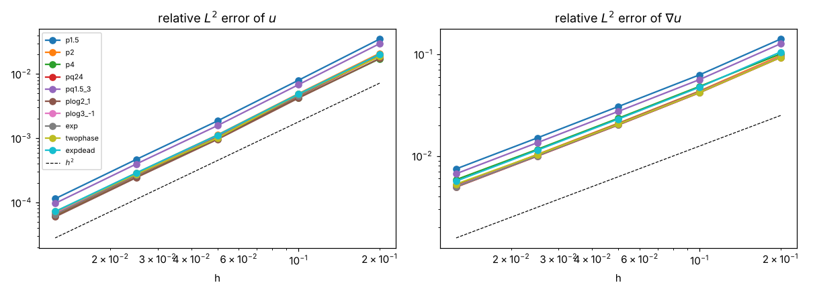
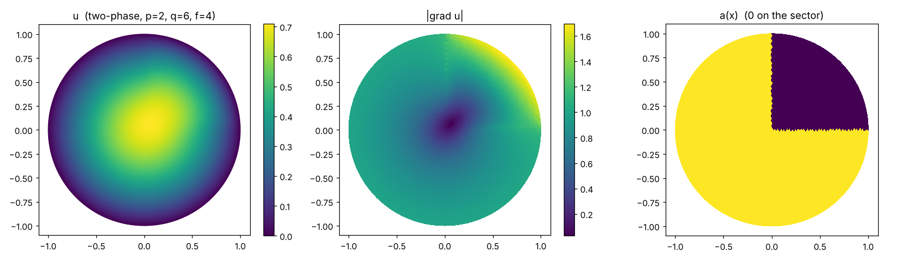
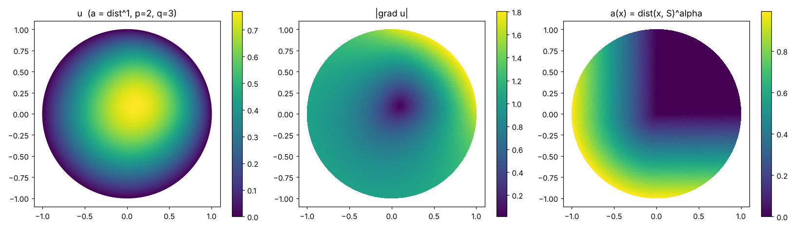
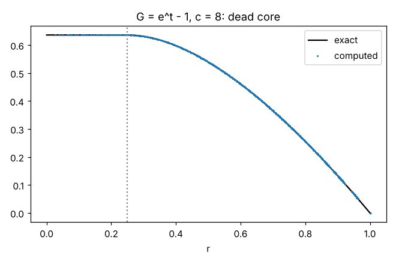

# glaplace — g-Laplacian solver for Young functions on general 2D domains

[](https://colab.research.google.com/github/jfbonder/glaplace/blob/main/notebooks/glaplace_colab.ipynb)

Python implementation of the **decomposition–coordination method** (augmented Lagrangian / ADMM) for the Dirichlet problem

$$
-\mathrm{div}\!\Big(g\big(x,|\nabla u|\big)\,\frac{\nabla u}{|\nabla u|}\Big)=f \ \text{ in }\Omega\subset\mathbb R^2,\qquad u=u_D\ \text{ on }\partial\Omega,
\qquad g=\partial_t G ,
$$

where $G(x,\cdot)$ is a Young function (convex, $G(x,0)=0$), with piecewise-linear (P1) finite elements. The solution is the minimiser of
$\int_\Omega G(x,|\nabla u|)\,dx-\int_\Omega fu\,dx$. It is the generalisation to arbitrary $G$ of
[`pxlaplace`](https://github.com/jfbonder/pxlaplace) (the $p(x)$-Laplacian, code of Aragón–Fernández Bonder–Rubio):
only the pointwise nonlinear step changes, everything else (assembly, one LU factorisation reused at every iteration) is the same.

The solver is independent of the domain: it only needs a triangulation. Examples of $G$ available out of the box:

| $G(t)$ | class | remark |
|---|---|---|
| $t^p/p$ | `PowerLaw(p)` | $p$-Laplacian |
| $t^p/p+t^q/q$ | `pq(p, q)` | $p$-$q$-Laplacian |
| $t^p/p+a(x)\,t^q/q$, $a\ge0$ | `pq(p, q, a)` | **two-phase** problem ($a$ may vanish on a region) |
| $t^p\log^a(1+t)$ | `PLog(p, a)` | needs $p+a>1$ and convexity (`check_young`) |
| $e^t-1-t$ | `Exp()` | $g(0)=0$; fails $\Delta_2$ |
| $e^t-1$ | `ExpLiteral()` | $g(0^+)=1>0$, fails $\Delta_2$; "dead core" where the flux is $\le 1$ |
| anything | `Custom(G, g)`, `from_expr("t**3/3+t**2/2")` | any convex $G$, $g=G'$ non-decreasing (sympy optional) |

and any sum $\sum_i w_i(x)\,G_i$ with weights $w_i\ge0$ (constants or functions of `(x, y)`).

## Contents

- [The method](#the-method) · [Installation](#installation) · [Usage](#usage) · [Choice of r](#choice-of-the-parameter-r)
- [Experiments](#experiments-all-with-an-exact-or-manufactured-solution) · [Tests](#tests) · [Theory: what is and what is not proved](#theory-what-is-and-what-is-not-proved)
- [Notes](#notes) · [License](#license)

## The method

Write $\nu=\nabla u$ and consider the augmented Lagrangian
$\mathcal L_r(u,\nu;\eta)=\int G(x,|\nu|)-\int fu+\int\eta\cdot(\nabla u-\nu)+\frac r2\int|\nabla u-\nu|^2$. Alternating minimisation in $u$ and in $\nu$
plus a multiplier step gives, starting from $\nu_0=\eta_0=0$:

1. $r(-\Delta u_n)=f+\mathrm{div}(\eta_n-r\nu_{n-1})$ (weak form: $r\!\int\nabla u_n\!\cdot\!\nabla\varphi=\int f\varphi+\int(r\nu_{n-1}-\eta_n)\!\cdot\!\nabla\varphi$) — linear, **same matrix at every iteration**, factorised once;
2. $\nu_n=t\,w/|w|$ with $w=\eta_n/r+\nabla u_n$, where $t\ge0$ solves $g(x,t)+r\,t=r|w|$ — a scalar monotone equation, solved **pointwise** by a vectorised bisection (in $\log t$, so tiny roots are resolved to relative accuracy $10^{-12}$; $t=0$ if $g(x,0^+)\ge r|w|$);
3. $\eta_{n+1}=\eta_n+r(\nabla u_n-\nu_n)$. (Then $\eta_{n+1}=g(x,|\nu_n|)\,\nu_n/|\nu_n|$: $\eta$ is the flux.)

Only the monotonicity of $g$ is used (no smoothness, no $\Delta_2$). $G(x,\cdot)$ is sampled at the barycentres of the triangles (piecewise-constant dependence on $x$).

## Installation

```bash
git clone https://github.com/jfbonder/glaplace && cd glaplace
pip install -e .                     # numpy, scipy, matplotlib
pip install triangle meshio sympy    # optional: polygon meshes / mesh import / Young functions and manufactured solutions from expressions
```

or just open the notebook in Colab (badge above): it embeds the package source and needs nothing else.

## Usage

```python
import numpy as np
import glaplace as gl

mesh = gl.disk_mesh(0.03)                      # or rectangle_mesh, polygon_mesh, sdf_mesh, from_meshio, from_txt, Mesh(V, T, dirichlet)
G = gl.pq(2, 4)                                # t^2/2 + t^4/4
S = gl.GLaplaceSolver(mesh, G, f=1.0, u_D=0.0) # set-up + factorisation (once)
res = S.solve(tol=1e-9, stop="residual")       # iterate; res.u = nodal values
mesh.plot(res.u)

# two-phase: a(x) vanishes on a sector
a = lambda x, y: np.where(np.arctan2(y, x) > 0.5, 1.0, 0.0)
G = gl.pq(2, 6, a)                             # t^2/2 + a(x) t^6/6
# any Young function
G = gl.PLog(2, 1) ;  G = gl.Exp() ;  G = gl.from_expr("t**3/3 + t**2/2") ;  G = gl.Custom(lambda t: t**3/3, lambda t: t**2)
gl.check_young(G)                              # numerical sanity check: G(0)=0, g >= 0, g nondecreasing
```

`f`, `u_D` and the weights are constants, arrays or vectorised functions `fun(x, y)`. `GLaplaceSolver(mesh, G, f, u_D, r=1.0, f_degree=1)`;
`f_degree=1` is the barycentre rule (exact only for constant `f`; use `f_degree=2` for general `f`).

`solve(tol, max_iter, stop, init, ...)`:

- `stop="rel_u"` (default): $\|u_n-u_{n-1}\|_2/\|u_{n-1}\|_2<$ `tol`;
- `stop="residual"`: $\|\nabla u_n-\nu_n\|_{L^2}/(1+\|\nabla u_n\|_{L^2})<$ `tol` (primal residual; scale-free, **recommended**, in particular for tiny or huge solutions);
- `init="zero"` or `"random"`.

The returned `SolveResult` has `u`, `nu`, `eta` (element-wise vector fields), `iterations`, `converged`, `time_setup`, `time_iter` and `history` (`rel_u`, `residual`, `energy` per iteration). `S.energy(u)` evaluates the discrete energy.

Error helpers in `P1Space(mesh)`: `l2_error(uh, u_exact)` and `grad_error_Lp(uh, grad_exact, p)` compute the **true** finite-element errors (degree-4 quadrature);
`norm_L2` etc. applied to nodal differences measure $\|I_hu-u_h\|$, which is *not* the FE error (supercloseness makes it much smaller).

Exact / manufactured solutions for testing (`glaplace.exact`):

- `radial_torsion(G, c)`: disk, $f=c$, $u=0$: $g(|u'|)=cr/2$, $u(r)=\int_r^1g^{-1}(cs/2)\,ds$ computed to $\sim10^{-10}$; $G$ may depend on $r$ radially (e.g. `pq(2, 4, a)` with $a=\mathbf 1_{r>1/2}$);
- `manufactured("t**2/2 + (1+x)*t**4/4", "exp(x+y)")` (sympy): returns $f$, $u$, $\nabla u$ for any $G(t,x,y)$ and $u(x,y)$ with non-vanishing gradient.

## Choice of the parameter r

The iteration converges for any $r>0$ (see below) but its speed depends strongly on $r$: it is fastest when $r$ is of the order of $g(t)/t$ at the typical size $t$ of $|\nabla u|$
(for $G=t^p/p$ and $|\nabla u|\approx 1$, $r\approx1$; the larger the gradients or the faster the growth of $G$, the larger $r$). Examples
(`examples/manufactured.py`, `examples/exp_dead_core.py`):

| problem | r=1 | r=10 | r=30 | r=100 | r=300 |
|---|---|---|---|---|---|
| $G=t^2/2+(1+x)t^4/4$, $u=e^{x+y}$, n=40: iterations to residual $10^{-10}$ | >5000 | 1167 | 396 | **208** | 516 |
| $G=e^t-1$, dead-core torsion $c=8$, h=0.05: iterations to residual $10^{-8}$ | >6000 | 650 | **244** | | |

(for the dead-core case $r=3$ needs 2139 iterations and $r=1$ does not converge in 6000).

## Experiments (all with an exact or manufactured solution)

Torsion on the unit disk, $f=c$, $u=0$ on $\partial B_1$, exact radial solution computed with `exact.radial_torsion`. **True** errors by quadrature, fitted order $t$ in
$\text{error}\sim h^t$ over the 3 finest of 5 meshes ($h=0.2,\dots,0.0125$, up to 23 227 nodes); stopping: residual $<10^{-9}$, $r=1$ except the dead-core case ($r=30$).
Script and raw data: [`examples/convergence_order.py`](examples/convergence_order.py), [`results/convergence_order.csv`](results/convergence_order.csv).

```bash
python examples/convergence_order.py --plot --jobs 3
```



| case | $G$ | $t$ in $L^2$ ($u$) | $t$ in $L^2$ ($\nabla u$) | $t$ in sup (nodes) | iterations (finest mesh) |
|---|---|---|---|---|---|
| `p1.5` | $t^{1.5}/1.5$ | 2.01 | 1.02 | 1.94 | 837 |
| `p2` | $t^2/2$ | 2.00 | 1.02 | 2.02 | 29 |
| `p4` | $t^4/4$ | 2.00 | 1.00 | 1.17 | 176 |
| `pq24` | $t^2/2+t^4/4$ | 2.00 | 1.01 | 2.02 | 26 |
| `pq1.5_3` | $t^{1.5}/1.5+t^3/3$ | 2.01 | 1.02 | 1.98 | 843 |
| `plog2_1` | $t^2\log(1+t)$ | 2.00 | 1.01 | 1.37 | 60 |
| `plog3_-1` | $t^3/\log(1+t)$ | 2.00 | 1.02 | 2.02 | 33 |
| `exp` | $e^t-1-t$ | 2.00 | 1.01 | 2.02 | 25 |
| `twophase` | $t^2/2+a(r)t^4/4$, $a=\mathbf 1_{r>1/2}$ | 1.90 | 0.98 | 0.79 | 27 |
| `expdead` | $e^t-1$, $c=8$ (dead core $r<1/4$) | 1.97 | 1.01 | 1.11 | 3000 (not converged, see below) |

Observations.

- With smooth $G$ the method has the optimal P1 behaviour: order 2 in $L^2$ and 1 in the $L^2$ norm of the gradient, **independently of $G$**, including $e^t-1-t$ (no $\Delta_2$) and $t^p\log^a(1+t)$ with negative $a$. The nodal sup order is lower for `p4` and `plog2_1` (1.17 and 1.37), presumably because $u$ has little regularity at the origin, where $\nabla u=0$ and $g$ is not smooth enough; the $L^2$ orders are not affected.
- Two-phase: when $a$ jumps across a circle which is *not* aligned with the mesh, the order drops (1.90 in $L^2$, 0.79 in sup norm, because $u'$ jumps at the interface; as for a discontinuous exponent in `pxlaplace`). It is a limitation of sampling $a$ at the barycentres and of the unresolved interface.
- `expdead` ($g(0^+)=1$): the iteration converges slowly (like for the 1-Laplacian). On the two finest meshes the residual stalled at $2\times10^{-8}$ and $4\times10^{-8}$ after 3000 iterations, but the errors had stopped changing (order $\approx2$). The solution is exactly flat in the computed dead core: $\max|\nabla u_h|<10^{-7}$ for $r<0.2$ (`examples/exp_dead_core.py`).
- The $p$-Laplacian with $p$ close to 1 is slow (837 iterations at $p=1.5$ on the finest mesh): see the `pxlaplace` repo.

Other scripts: `python examples/two_phase.py --plot` (disk, $G=t^2/2+a(x)t^6/6$, $a=0$ on a quarter-disk sector; no explicit solution), `python examples/exp_dead_core.py --plot` (dead core, study of $r$), `python examples/manufactured.py` ($x$-dependent $G$: order 2.00 in $L^2$, 1.00 in $H^1$).



Two-phase with a **Hölder** coefficient, $G=t^2/2+\operatorname{dist}(x,S)^\alpha t^3/3$ ($S$ the first quadrant, $\alpha=1$, so $q\le p+\alpha$): `python examples/two_phase_holder.py --plot` (compares with the indicator coefficient; $\max|\nabla u_h|$, energy and $\max u_h$ stabilise under refinement).





## Tests

```bash
pip install -e ".[test]"
pytest -q
```

19 tests: Young-function algebra and `check_young`; the scalar equation for each $G$ (including $g(0^+)>0$); $p=2$ vs. the exact Poisson solution; radial torsion for $p=4$, $p$-$q$, $t^2\log(1+t)$, $e^t-1-t$ and the radial two-phase (order $\approx 2$); dead core of $e^t-1$; manufactured solution with $x$-dependent $G$; the computed $u_h$ minimises the discrete energy (random perturbations); independence of the limit from the initialisation on a two-phase (sector) problem.

## Theory: what is and what is not proved

The method is the decomposition–coordination (augmented Lagrangian, ADMM) scheme of Glowinski; the convergence theory, the examples where the key assumption (S) holds or fails, the discrete problem, the Lavrentiev phenomenon and the experiments are in [`paper/main.pdf`](paper/main.pdf) (LaTeX source and scripts in `paper/`). Summary:

- **Continuous level.** Assumption (S): the augmented Lagrangian has a saddle point in $H^1_0\times L^2\times L^2$ (the solution $u$ is in $H^1_0$ with flux in $L^2$, e.g. $\nabla u\in L^\infty$). Under (S) and convexity of $\int G$ only, the iteration converges weakly; strong convergence holds in the cases stated in the paper (including $1<p<2$ in $W^{1,p}_0$). Without (S) the iterates are unbounded.
- **Discrete level (what the code does).** For a fixed mesh, every $r>0$ and every convex $G$ with superlinear growth, the iteration converges.
- **Lavrentiev phenomenon.** For some $G(x,\cdot)$ (e.g. double phase with large $q-p$) conforming finite elements need not approximate the continuous minimiser.
- The finite-element error orders (2 in $L^2$, 1 in $H^1$ for smooth $G$ on smooth solutions) are only **observed**, not proved.

## Notes

1. $G(x,\cdot)$ with $x$-dependence is sampled at barycentres; discontinuities of $a(x)$ not aligned with the mesh reduce the order (see two-phase above).
2. $G=e^t-1$ (the function written literally) has $g(0^+)=1\neq0$: the flux has a jump at $\nabla u=0$ (like the 1-Laplacian) and there is a dead core wherever the flux is $\le1$. If a function with $g(0)=0$ is wanted use `Exp()` $=e^t-1-t$.
3. `stop="residual"` is recommended: `rel_u` can stop too early when the iteration is slow, and absolute criteria are inadequate for very small solutions.
4. Timings in the examples were measured in a shared cloud sandbox and are only indicative.

## License

MIT — see [`LICENSE`](LICENSE). Copyright (c) 2026 Adriana Aragón, Julián Fernández Bonder.
